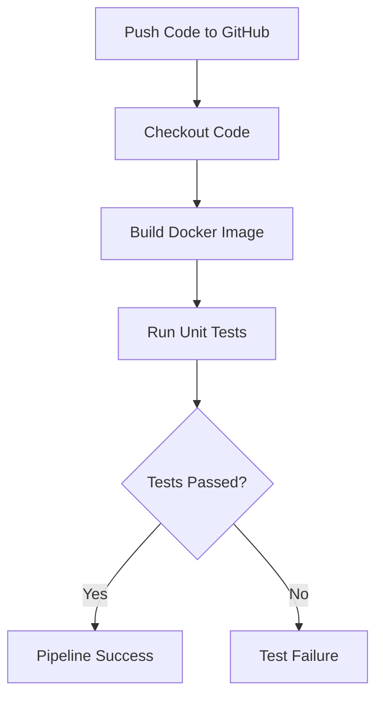

# Library-management-system

## Test Cases

| Test Case | Description | Expected Result |
|---|---|---|
| TC01 | Add a new book | Book is added successfully |
| TC02 | Add a new member | Member is added successfully |
| TC03 | Borrow a book | Book is borrowed successfully |
| TC04 | Search for a book | Matching book is returned |
| TC05 | Return a book | Book is returned successfully |

## Pipeline

The CI Pipeline consists of:

1. Checkout Code
2. Build Docker Image
3. Run Unit Tests Inside Docker
4. Report Test Results

## Test Failure Stage

Test failures are detected during the
Run Tests Inside Docker stage.

If a test fails, the pipeline reports
a failure and stops the successful build process.

## Docker Integration

Docker provides an isolated environment
for running the project tests.

GitHub Actions builds the Docker image
and executes unit tests inside the container.

## Pipeline Diagram

